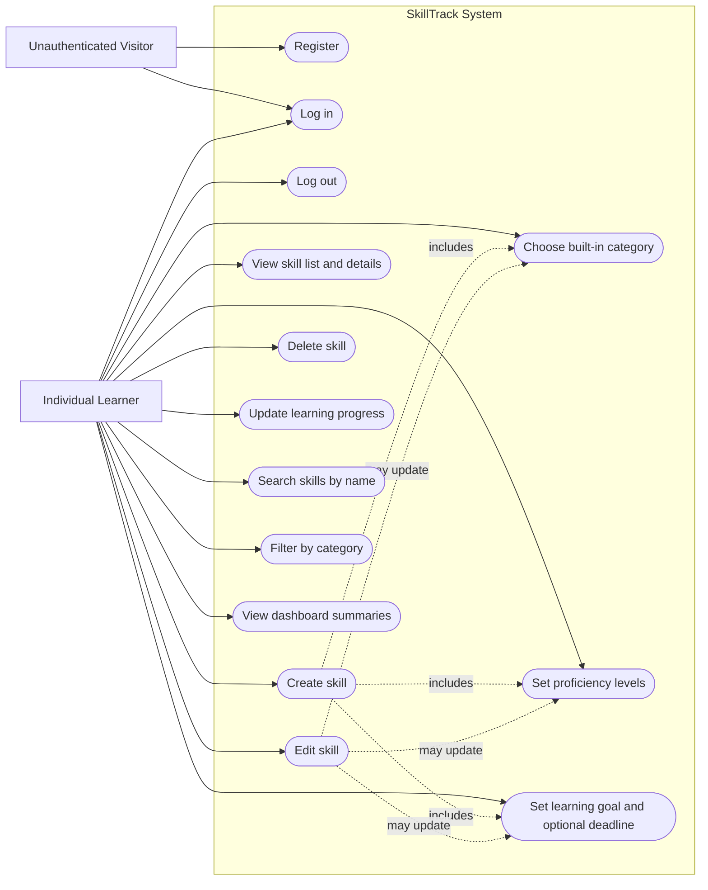

# Phase 2.2 — Use Case Diagram

**Status:** Draft for review  
**Related documents:** [Actors and System Boundary](01-actors-and-system-boundary.md), [Requirements](../requirements.md), [Decision Log](../decisions.md)

This diagram is a use-case overview for the MVP. It uses a Mermaid flowchart to keep the diagram renderable in GitHub Markdown; the oval nodes represent use cases and the subgraph represents the SkillTrack system boundary.

## Use Cases Included

| ID | Use case | Actor | Requirement mapping |
| --- | --- | --- | --- |
| UC-01 | Register | Unauthenticated Visitor | FR-01 |
| UC-02 | Log in | Visitor / Individual Learner | FR-02 |
| UC-03 | Log out | Individual Learner | FR-02 |
| UC-04 | Create skill | Individual Learner | FR-05, FR-09, FR-10, FR-11 |
| UC-05 | View skill list and details | Individual Learner | FR-06, FR-14 |
| UC-06 | Edit skill | Individual Learner | FR-07, FR-09, FR-10, FR-11, FR-13 |
| UC-07 | Delete skill | Individual Learner | FR-08 |
| UC-08 | Choose built-in category | Individual Learner | FR-09 |
| UC-09 | Set proficiency levels | Individual Learner | FR-10 |
| UC-10 | Set learning goal and optional deadline | Individual Learner | FR-11 |
| UC-11 | Update learning progress | Individual Learner | FR-13, FR-14 |
| UC-12 | Search skills by name | Individual Learner | FR-12 |
| UC-13 | Filter skills by category | Individual Learner | FR-12 |
| UC-14 | View dashboard summaries | Individual Learner | FR-15 |

## Diagram Notes

- Password reset, account recovery, and email verification are excluded from the MVP.
- All skill-related use cases require authentication and must enforce ownership on the backend.
- Search and filtering must operate only on the authenticated user's own skills.
- The category, proficiency, goal, and deadline use cases are shown separately to clarify requirements, although they may appear as fields in the create/edit skill form.
- The dashed relationships are explanatory rather than strict UML `include` or `extend` semantics. The detailed use case descriptions will define required versus optional behavior more precisely.

## Review Checklist

- [ ] Confirm the actors and use cases match the agreed MVP scope.
- [ ] Confirm that registration, login, and logout are the only account-access workflows shown.
- [ ] Check that no use case exposes another user's data.
- [ ] Review requirement mappings before marking the diagram complete.
