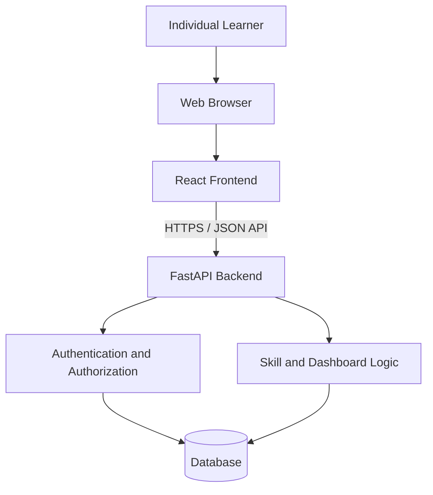

# Phase 3.1 — Application Architecture

**Status:** Accepted  
**Scope:** MVP architecture proposal; authentication details, database schema, API contracts, and deployment provider remain separate design tasks.

## 1. Architecture goals

- Keep the React interface separate from backend business rules and persistence.
- Expose a documented HTTP API so frontend and backend can be developed and tested independently.
- Enforce authentication and per-user data ownership on the backend.
- Keep the initial local setup simple while preserving a clear path to persistent production hosting.
- Avoid introducing services or infrastructure that the MVP does not need.

## 2. Proposed high-level architecture

The diagram is logical rather than a deployment topology. Authentication/authorization and skill/dashboard logic are responsibilities within the backend, not necessarily separate services.

## 3. Component responsibilities

### React frontend

- Render registration, login, dashboard, skill list, skill detail, and create/edit forms.
- Manage UI state such as loading, validation feedback, empty states, and errors.
- Send API requests and render returned data.
- Provide search and built-in category filtering through the API or client-side presentation as decided in API design.
- Never be the sole enforcement point for authentication or data ownership.

### FastAPI backend

- Expose REST-style endpoints with JSON request and response bodies.
- Validate incoming data and return consistent HTTP status codes and error responses.
- Apply business rules for skill fields, progress range, completion, and dashboard calculations.
- Authenticate requests and authorize access to each user's records.
- Keep secrets and configuration outside source control, using environment variables or the selected host's secret configuration.

### Persistence layer

- Use SQLite for local development and the initial MVP.
- Store users and their skills with an explicit ownership relationship.
- Keep database access behind a backend persistence layer/ORM so database-specific details stay out of business logic.
- Minimize database-specific SQL and use versioned migrations to manage schema changes.
- A later move to PostgreSQL should be manageable with this separation, but it still requires adapting and testing migrations, transferring existing data, and verifying schema and application behavior.
- Reassess PostgreSQL before production deployment if the hosting environment cannot guarantee persistent SQLite storage or operational requirements favor a managed database.

## 4. Main request path

1. The learner interacts with the React interface.
2. The frontend sends an HTTP request to the FastAPI API.
3. For protected operations, the backend verifies authentication.
4. The backend validates input and checks ownership for the requested resource.
5. The backend applies business rules and reads or writes the database.
6. The API returns a JSON response; the frontend updates the UI or presents an appropriate error.

Registration and login remain separate user actions. The specific session/token mechanism is intentionally undecided in this document and will be recorded in the authentication strategy decision.

## 5. Security and reliability boundaries

- Passwords must be stored as secure hashes, never plaintext.
- Protected API operations must enforce authentication on the backend.
- Skill reads, updates, and deletes must enforce record ownership; client-side filtering is not sufficient.
- CORS configuration controls which browser origins can make cross-origin requests; it does not replace authentication or authorization.
- Production traffic should use HTTPS.
- Secrets must not be committed to Git.
- API errors should not expose passwords, tokens, secret configuration, or another user's private data.
- The frontend should distinguish loading, empty, success, and failure states and avoid implying a write succeeded before the API confirms it.

## 6. Development and deployment approach

### Local development

- Run the React frontend and FastAPI backend as separate development processes.
- Configure the API base URL and other environment-specific values without hardcoding secrets.
- Use a local SQLite database file that is excluded from version control.
- Document setup commands and required environment variables in the project documentation.

### Deployment

- The frontend and backend may be deployed separately or together, depending on hosting options.
- The chosen environment must support the backend runtime, secure configuration, HTTPS, and persistent database storage.
- Verify persistence across restarts, authentication, and per-account data isolation before treating a public deployment as complete.
- Do not finalize the hosting topology until the deployment and storage constraints are evaluated.

## 7. Decisions intentionally left open

- Session-based versus token-based authentication.
- Exact database schema, constraints, and migration approach.
- ORM/database access library.
- API endpoint names, schemas, and error format.
- Frontend and backend hosting provider and final deployment topology.
- Exact built-in category catalogue.

These belong to subsequent Phase 3 design tasks and should not be inferred as finalized by this architecture draft.

## 8. Review checklist

- [x] Confirm React, FastAPI, and the API boundary reflect the intended MVP.
- [x] Confirm backend ownership enforcement and security responsibilities are clear.
- [x] Confirm SQLite is the initial database for local development and MVP.
- [x] Confirm open decisions remain open for their dedicated design tasks.
