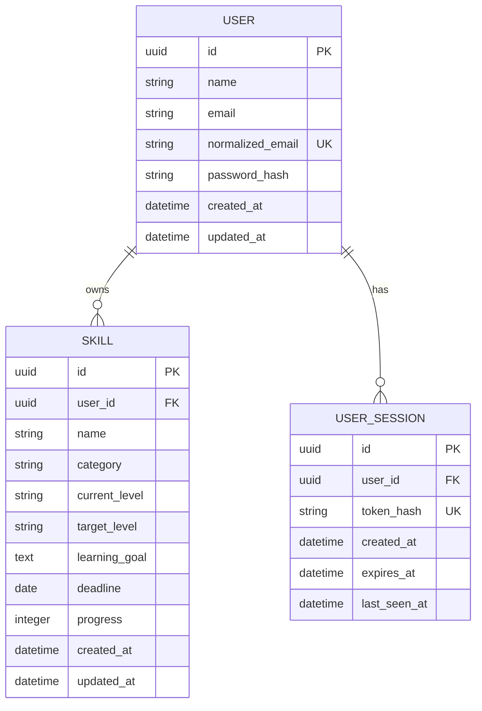

# Phase 3.2 — Data Model

**Status:** Accepted for MVP scope  
**Scope:** MVP entities, relationships, integrity rules, and persistence behavior. The accepted Phase 3.3 authentication strategy adds a server-managed session entity to the original User and Skill model.

## 1. Design goals

- Store each learner's account and private skills.
- Keep the schema small and aligned with the approved MVP scope.
- Enforce ownership and core data rules at the backend and database boundaries.
- Keep built-in categories application-provided; users cannot manage the category catalogue.
- Use an ORM/persistence layer and versioned migrations so SQLite can be used locally and PostgreSQL can be evaluated for production later.

## 2. Entity relationship

A user may have zero or more skills and sessions. Every skill and session belongs to exactly one user. The API must scope skill reads, updates, and deletes to the authenticated user.

## 3. Entity fields

### User

| Field | Type | Rules |
| --- | --- | --- |
| `id` | UUID | Primary key; generated by the application or persistence layer. |
| `name` | Text | Required; display name. |
| `email` | Text | Required; retain the address for display and communication. |
| `normalized_email` | Text | Required and unique; trim whitespace and normalize case before storing/looking up to prevent duplicate accounts that differ only by case. |
| `password_hash` | Text | Required; store only a secure password hash, never the submitted password. |
| `created_at` | Timestamp | Required; stored and interpreted in UTC. |
| `updated_at` | Timestamp | Required; refreshed when account data changes. |

The unique constraint on `normalized_email` is the authoritative duplicate-account check; application validation should translate a conflict into a clear response. Trim leading and trailing whitespace and normalize case before deriving this value.

### UserSession

| Field | Type | Rules |
| --- | --- | --- |
| `id` | UUID | Primary key. |
| `user_id` | UUID | Required foreign key to `User.id`; index this field. |
| `token_hash` | Text | Required and unique; hash of the opaque cookie token. Never persist the raw token. |
| `created_at` | Timestamp | Required; stored and interpreted in UTC. |
| `expires_at` | Timestamp | Required; session is invalid at or after this time. |
| `last_seen_at` | Timestamp | Required; update after successful authenticated use to enforce the accepted seven-day inactivity lifetime. |

Logout revokes the current session record. Permanently deleting a user cascades to their sessions.

### Skill

| Field | Type | Rules |
| --- | --- | --- |
| `id` | UUID | Primary key; generated by the application or persistence layer. |
| `user_id` | UUID | Required foreign key to `User.id`; index this field. |
| `name` | Text | Required; searchable skill name. |
| `category` | Text key | Required; must match a built-in category key accepted by the backend. |
| `current_level` | Text key | Required; one of Beginner, Intermediate, Advanced, Expert. |
| `target_level` | Text key | Required; one of Beginner, Intermediate, Advanced, Expert. |
| `learning_goal` | Text | Required; the learner's goal for this skill. |
| `deadline` | Date | Optional; a calendar date with no time component. |
| `progress` | Integer | Required; defaults to 0 and must be between 0 and 100 inclusive. |
| `created_at` | Timestamp | Required; stored and interpreted in UTC. |
| `updated_at` | Timestamp | Required; refreshed when the skill changes. |

Proficiency values and goal progress are separate fields with separate meanings. A change in progress must not automatically change either proficiency level.

## 4. Built-in categories

The MVP does not need a user-managed `Category` table. The application owns the category catalogue and validates each `Skill.category` value against it. Persist a stable category key rather than a display label so labels can be changed without rewriting skill records.

The accepted MVP catalogue is: Technology, Languages, Arts and Design, Business and Finance, Communication, Education and Academics, Health and Fitness, Sports, Culture and Humanities, Personal Development, and Spirituality. Users cannot enter custom categories, so there is no “Other” category. Store stable category keys; the backend validates keys against this fixed catalogue. If categories later need admin management, localization, or metadata, a dedicated table can be introduced through a migration.

## 5. Integrity and deletion rules

- Enforce `normalized_email` uniqueness.
- Require `Skill.user_id` to reference an existing user.
- Delete a user's skills when that user is permanently deleted (foreign-key cascade).
- Enforce progress in the inclusive range 0–100 and allow only the four defined proficiency values.
- Validate category keys against the built-in catalogue in the backend before persistence.
- Use database constraints where supported by the chosen ORM and migration tooling; keep backend validation as the source of user-facing validation errors.
- A skill at 100% is completed; no separate completion flag is needed.
- The MVP has no archive or restore use case. Delete permanently removes the skill record, and dashboard “active skills” means the user's remaining skill records.

## 6. Indexes and dashboard calculations

- Add an index on `Skill.user_id` for per-user listing and ownership-scoped access.
- Consider a composite index on `(user_id, category)` to support category filtering.
- Search by skill name must remain scoped by `user_id`. Choose any database-specific search optimization only after the API/query design establishes its needs.
- Calculate total skills, completed skills (`progress = 100`), and average progress from the authenticated user's skill records.
- For a user with no skills, return the agreed empty-state representation; do not calculate an average by dividing by zero.

## 7. SQLite and PostgreSQL compatibility

Use an ORM and keep persistence operations behind the backend persistence layer. Prefer portable column types and application-level category keys; avoid database-specific SQL unless a measured need justifies it. Keep schema changes in versioned migrations.

A future PostgreSQL move will require applying/adapting migrations, transferring existing rows, configuring PostgreSQL constraints and indexes, and checking behavior with representative data. It should be manageable with this separation, but it is not a configuration-only switch. Keep SQLite and PostgreSQL behavior in view when selecting UUID representation, timestamp handling, and migration features.

## 8. Review questions

- Confirm whether deleting a skill permanently removes it or moves it to an archive/trash state.
- Use the accepted built-in catalogue: Technology, Languages, Arts and Design, Business and Finance, Communication, Education and Academics, Health and Fitness, Sports, Culture and Humanities, Personal Development, and Spirituality. No custom or “Other” category is available.
- Use UUID identifiers for users and skills. Normalize account email by trimming leading/trailing whitespace and comparing case-insensitively.
- The Phase 3.2 User and Skill model is accepted; Phase 3.3 adds UserSession as required by the accepted cookie-session strategy.

## 9. Acceptance checklist

- [x] User, Skill, and (after Phase 3.3) UserSession fields cover the approved MVP requirements.
- [x] User-to-skill ownership and permanent deletion behavior are accepted.
- [x] Built-in category storage and validation approach are accepted.
- [x] Progress, proficiency, and dashboard rules are represented correctly.
- [x] SQLite-first and future PostgreSQL migration constraints are documented.
